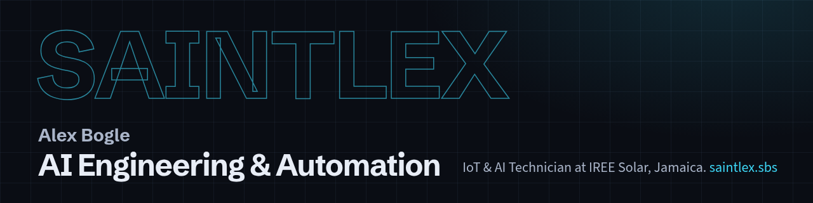

# Alex Bogle | AI Engineering & Automation

I build practical AI systems, agents, workflows and integrations, and I ship them tested, secured and documented.

**Current role:** IoT & AI Technician at IREE Solar, Jamaica. AI Engineering & Automation is the discipline, not the job title.

## Building

- **Staff assistant and website chat.** Answers product questions from manufacturer documents, with sign-in, rate limits, prompt and output guards, and a test set I rerun after every change. *Staff pilot running.*
- **Field automation.** The company website, ServiceM8 and Zoho, connected so a job and an invoice move together. A person approves every live write. *Professional work.*
- **Solar and battery performance reports.** Plain-language customer and internal reports built from read-only monitoring data. A reporting gap is not an equipment fault. *Professional work.*
- **AI-assisted engineering workstation.** Local memory, a task API, nightly upkeep and guard rails on risky commands. *Personal tooling.*

These repos are private. More on [saintlex.sbs](https://saintlex.sbs/#work).

## Featured work

| Repository | What it is | Category |
| --- | --- | --- |
| [agentic-systems-lab](https://github.com/SaintChris/agentic-systems-lab) | Six agent roles on a shared task queue, a dashboard that runs on demo data, tests in CI | Lab |
| [iot-energy-telemetry-lab](https://github.com/SaintChris/iot-energy-telemetry-lab) | Synthetic solar and battery telemetry over MQTT: device identity, topic design, JSON validation, offline tests | Lab |
| [sp-agent-session-sync](https://github.com/SaintChris/sp-agent-session-sync) | Puts Claude Code, T3 Code, Codex and Grok sessions onto the matching Super Productivity task | Personal project |
| [omarchy-super-productivity](https://github.com/SaintChris/omarchy-super-productivity) | Omarchy bar widget for the current task and today's time, with start and stop | Personal project |
| [saintlex.sbs](https://saintlex.sbs/) | My portfolio site: work, case studies with measured results, and open source (private repository) | Personal project |

The RAG evaluation lab stays private until its publication security review is finished.

## Open-source contributions

Shipped:

- [Open WebUI iOS app](https://github.com/JoaoZaokk/openwebui-ios/issues/15): my feature write-up became follow-up suggestion buttons under each answer. Credited as co-author on [ff1ae6e](https://github.com/JoaoZaokk/openwebui-ios/commit/ff1ae6e).
- [Super Productivity](https://github.com/super-productivity/super-productivity/pulls?q=is%3Apr+author%3ASaintChris+is%3Amerged): local REST API routes to log time on a given day ([#10826](https://github.com/super-productivity/super-productivity/pull/10826)) and for notes ([#10827](https://github.com/super-productivity/super-productivity/pull/10827)), and a flag to start the app minimized ([#11321](https://github.com/super-productivity/super-productivity/pull/11321)).
- [awesome-second-brain](https://github.com/aristoapp/awesome-second-brain/pull/19): setup guide, example workflow, comparison pages and solution profiles.
- [ed-donner/agents](https://github.com/ed-donner/agents/pull/1414): week 1 notes in the community contributions of the agentic AI course.

In review:

- Super Productivity: tag and project write routes ([#10828](https://github.com/super-productivity/super-productivity/pull/10828)), a port flag so two profiles can each run the REST API ([#11432](https://github.com/super-productivity/super-productivity/pull/11432)), and custom titles for calendar time blocks ([#11438](https://github.com/super-productivity/super-productivity/pull/11438)).
- [Chroma](https://github.com/chroma-core/chroma/pull/7230): Haystack integration examples for the docs.
- [HermesHub](https://github.com/amanning3390/hermeshub/pull/119): open-source contribution and platform-picker skills.

## Engineering principles

- Read before changing. Find out what the system does now and what must still work afterward.
- Collect evidence: logs, data and the actual error.
- Make small changes I can undo, with a restore point first.
- Keep secrets and customer data out of code, notes and public pages.
- Verify against the test, then write down what changed.
- I use AI coding agents for much of the implementation. I set the scope, review the output and check the result myself before it ships.

## Stack

- **Daily:** Linux, Bash, Git, Docker, GitHub Actions, Python, Node.js, TypeScript, Rust.
- **AI and data:** document retrieval with hybrid search, evaluation sets, prompt and output guards, AI coding agents.
- **Automation and integration:** n8n, REST APIs, ServiceM8, Zoho, Google Workspace, Cloudflare.
- **Energy systems:** Tesla Powerhub and Powerwall, Fronius, eGauge, solar and battery monitoring, outage and reserve analysis.
- **Foundation:** device and firmware troubleshooting, networking diagnostics.
- **Learning:** AWS fundamentals, MQTT and IoT integration (lab only).

## Links

- Portfolio: [saintlex.sbs](https://saintlex.sbs/)
- LinkedIn: [alex-bogle](https://www.linkedin.com/in/alex-bogle/)
- Email: [bogle.alex@hotmail.com](mailto:bogle.alex@hotmail.com)

Forks on this account are reference material, not my own work.
